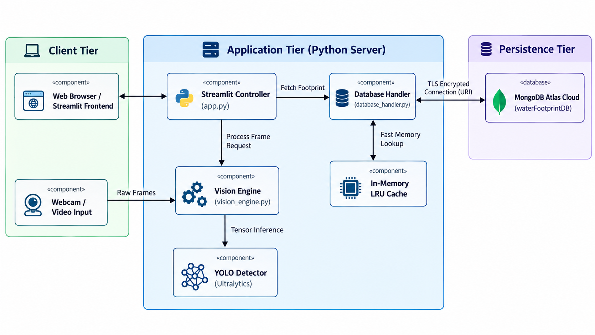
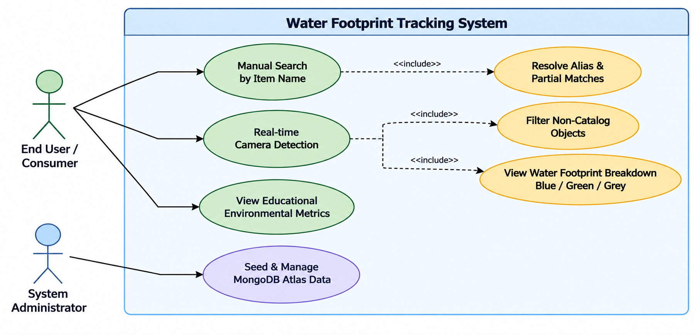
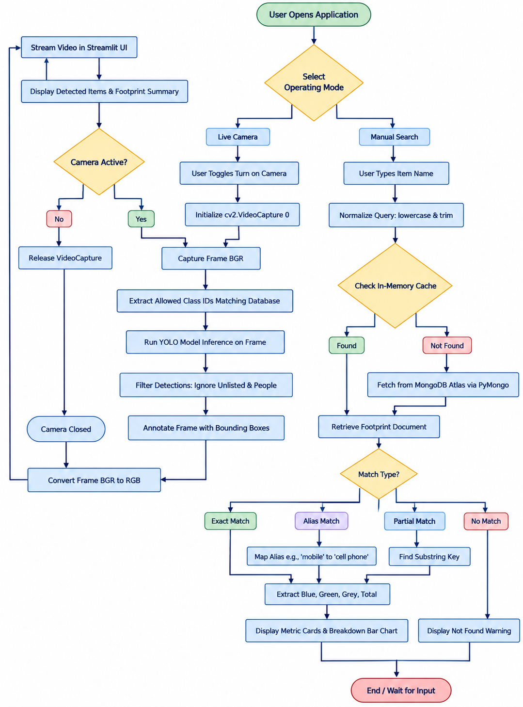
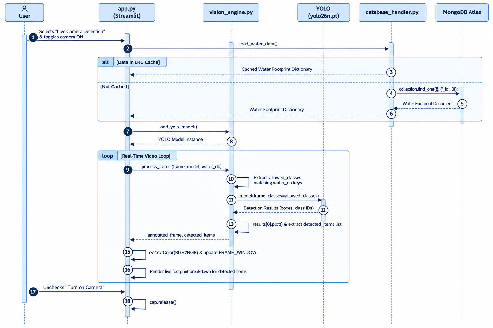
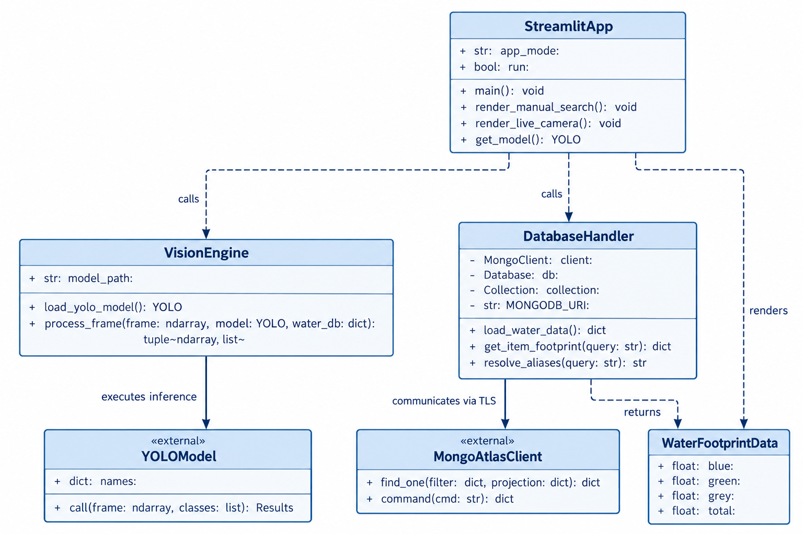
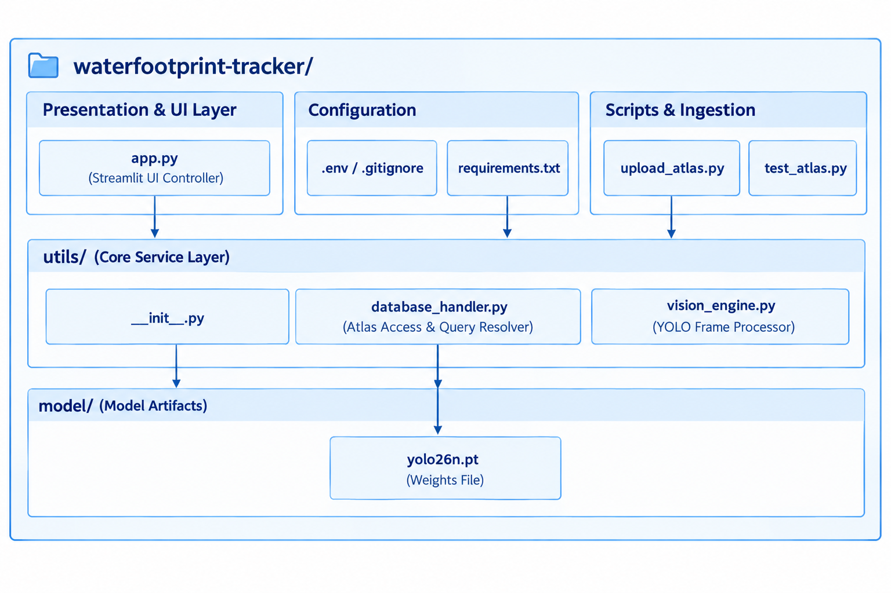
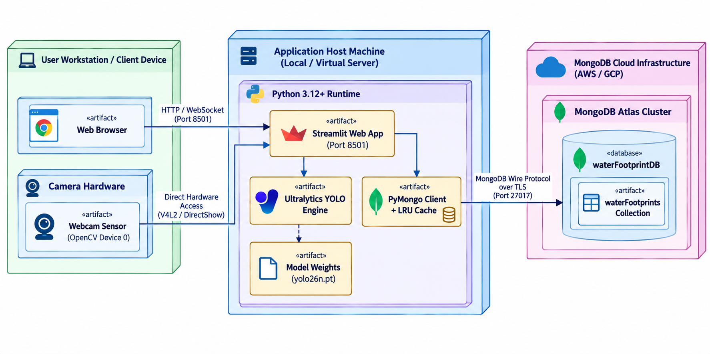

# Water Footprint Tracker

A smart AI-powered sustainability platform that helps users estimate the hidden freshwater cost of everyday products. By combining computer vision, product lookup, and water-footprint analytics, the project turns the invisible water behind consumer goods into a clear, interactive, real-time insight.

<p align="center">
  
</p>

## Overview

The Water Footprint Tracker is designed to raise awareness about freshwater scarcity and the hidden environmental cost embedded in common products. Many goods require water not only during direct use, but throughout their production lifecycle—from agriculture and manufacturing to processing and transportation.

This project brings that concept into a user-friendly tool with a Streamlit-based interface. Users can either:

- search for an item manually, or
- use a live webcam feed to detect objects automatically

The system uses YOLO object detection and OpenCV to identify items in real time, then matches the detected or entered label against a water-footprint database to estimate the product's environmental impact.

## Problem it addresses

Freshwater is a limited and increasingly stressed resource. Everyday items such as food, clothing, and electronics consume far more water than most people realize because much of it is embedded in their supply chain.

This app helps users:

- understand the hidden water cost of products
- see the difference between direct and indirect water use
- evaluate impact by water type
- make more sustainable decisions in daily life

## Key features

- AI-based object detection using YOLO
- Live webcam object recognition with OpenCV
- Manual product search and lookup
- Alias and partial match resolution for product names
- MongoDB Atlas integration for storing water-footprint data
- In-memory LRU caching for fast repeated queries
- Real-time breakdown of:
  - Blue Water
  - Green Water
  - Grey Water
- Metric cards and bar chart visualizations
- Streamlit interface designed for an intuitive, Google Lens-like experience

## Workflow

The application follows this end-to-end process:

1. The user selects either manual lookup or camera mode.
2. OpenCV captures video frames from the webcam or reads uploaded image data.
3. YOLO identifies goods in the frame and filters out irrelevant objects such as people or background clutter.
4. The detected label or user-entered text is normalized and matched to possible product aliases and database entries.
5. The item name is resolved against a MongoDB Atlas dataset.
6. The app retrieves the corresponding water-footprint values and applies LRU caching for performance.
7. The system calculates total water use and breaks it down into:
   - Blue water: surface and groundwater consumed
   - Green water: rainwater used by plants and soil moisture
   - Grey water: freshwater needed to dilute pollutants
8. Results are rendered as interactive cards and charts for quick interpretation.

## Water footprint components

### Blue Water
Blue water refers to freshwater from surface and groundwater sources such as rivers, lakes, and aquifers. It represents water consumed or withdrawn for production and is especially important in water-stressed regions.

### Green Water
Green water is rainwater stored in the soil and used by plants through evapotranspiration. It is particularly relevant for agricultural products and crops grown without irrigation.

### Grey Water
Grey water is an estimate of the freshwater needed to dilute pollutants to meet water-quality standards. It reflects the pollution footprint and the water required to assimilate contamination from industrial or agricultural processes.

## System architecture

The project is structured around a simple yet powerful architecture:

- Frontend: Streamlit web application
- Computer vision: OpenCV + YOLO
- Query processing: normalized text matching and alias resolution
- Data layer: MongoDB Atlas
- Performance layer: in-memory LRU caching
- Visualization layer: metrics and charts in the dashboard

## Architecture diagrams

The repository includes several design diagrams in the `docs/` folder to explain the overall system and behavior. These diagrams cover the project architecture and process flow.

### Use case diagram



### Activity diagram



### Sequence diagram



### Component diagram


### Class diagram



### Package diagram



### Deployment diagram



## Technology stack

- Python
- Streamlit
- OpenCV
- YOLO
- MongoDB Atlas
- Pandas
- NumPy
- LRU caching
- Computer vision and image processing

## Project structure

```text
waterfootprint-tracker/
├── app.py
├── docs/
│   ├── ActivityDiagram.png
│   ├── ClassDiagram.png
│   ├── ComponentDiagram.png
│   ├── DeploymentDiagram.png
│   ├── PackageDiagram.png
│   ├── SequenceDiagram.png
│   └── UseCaseDiagram.png
├── model/
│   └── yolo26n.pt
├── utils/
├── requirements.txt
├── test_atlas.py
├── upload_atlas.py
├── README.md
├── .gitignore
└── ...
```

## How to use

### Manual search mode
1. Enter a product name or everyday item.
2. Optionally choose a quantity.
3. Submit the query.
4. View the estimated water footprint and component breakdown.

### Image detection mode
1. Upload a clear image of one or more consumer goods.
2. Run the detection model.
3. Inspect recognized objects and their estimated water impact.

### Live camera mode
1. Start the webcam scanner.
2. Point the camera toward an object or product.
3. Observe live detection and water-footprint analytics.

## Benefits

This project promotes awareness and informed decision-making by making hidden environmental impacts visible. It helps users connect their everyday purchases with real-world resource consumption and encourages more responsible consumption behavior.

## Example use case

A user points the webcam at a packaged item or types in a search like “phone,” “shirt,” or “coffee.” The system identifies the object, resolves the relevant product entry, and displays the total water footprint with the split between blue, green, and grey water. This gives a quick, intuitive view of how water-intensive the product may be.

## Installation

1. Clone the repository.
2. Create a virtual environment.
3. Install dependencies:

```bash
pip install -r requirements.txt
```

4. Ensure the YOLO model file is present in the `model/` directory.
5. Configure MongoDB Atlas access for the database if required by your environment.

## Run the app locally

```bash
streamlit run app.py
```

Then open the local Streamlit URL in your browser to interact with the application.

## Summary

The Water Footprint Tracker is an AI-driven environmental sustainability tool that combines product recognition, database lookup, and water-footprint analysis into a streamlined user experience. It turns everyday shopping and consumption decisions into a visible, understandable environmental story—helping users move toward more water-conscious behavior.

---

This project combines modern AI, computer vision, and sustainability analytics to offer a practical, user-friendly way to make the hidden water cost of products more transparent.
